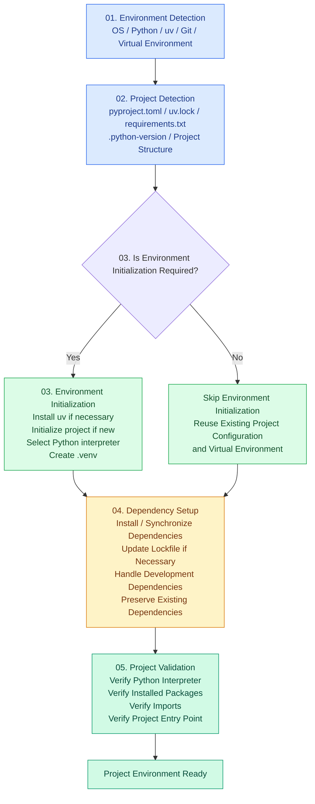

01. Environment Detection

辨識目前執行環境
- OS detection (Windows / macOS / Linux)
- Python installation & version
- uv availability & version
- git availability & version
- Existing virtual environment

02. Project Detection

辨識目前專案狀態
- pyproject.toml
- uv.lock
- requirements.txt
- .python-version
- Existing project structure

03. Environment Initialization

建立開發環境
- Install uv if necessary
- Initialize project if new
- Create .venv
- Select Python interpreter

04. Dependency Setup

處理專案依賴
- Install dependencies
- Synchronize lock file
- Handle development dependencies
- Preserve existing dependencies

05. Project Validation

確認環境是否正確
- Verify Python interpreter
- Verify installed packages
- Verify imports
- Verify project entry point

## Python Project Setup Workflow

