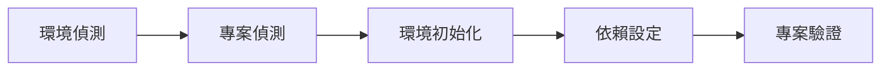

# Python Project Setup

依序完成下列階段，設定並驗證 Python 專案環境。

## 流程

1. [Environment Detection](environment-detection.md) — 偵測 OS、Python、uv、Git 與虛擬環境。
2. [Project Detection](project-detection.md) — 偵測專案根目錄、設定檔、依賴來源與專案結構。
3. [Environment Initialization](environment-initialization.md) — 準備 Python 與 `.venv`。
4. [Dependency Setup](dependency-setup.md) — 安裝並同步依賴。
5. [Project Validation](project-validation.md) — 驗證 Python、依賴、匯入與入口點。



## 執行規則

- 偵測階段不得修改環境或專案檔案。
- 完成偵測後再執行設定。
- 優先使用 `uv`；不要將專案現有設定或依賴來源強制改為新架構。
- 遇到衝突、設定不明或可能破壞既有環境時，先停止並報告。
- 每個階段完成後回報簡要結果與下一步。

## 階段摘要

每個階段輸出：

```text
狀態：完成 / 部分完成 / 失敗
偵測到的設定：
執行的動作：
待解決的問題：
下一步：
```
